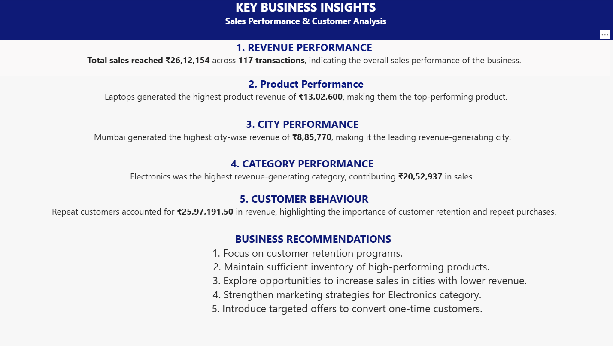

# Sales Performance Dashboard

## Project Overview
An interactive Power BI dashboard developed to analyse sales performance, product trends, city-wise revenue, payment methods, and customer behaviour.

This project demonstrates data cleaning, data analysis, DAX calculations, and business intelligence reporting.

## Tools & Technologies
- Microsoft Power BI Desktop
- Power Query
- DAX
- CSV Dataset

## Dashboard Pages

### 1. Sales Overview
- Total Sales, Total Transactions, Total Customers
- Average Order Value and Total Quantity Sold
- Monthly Revenue Trend
- Product-wise Revenue
- City-wise Revenue
- Payment Method Analysis
- Category-wise Revenue
  

### 2. Customer Behaviour Analysis
- Customer Segmentation
- Repeat vs One-time Customers
- Revenue by Customer Segment

### 3. Key Insights & Recommendations
- Revenue Performance
- Product Performance
- City Performance
- Category Performance
- Customer Behaviour
- Business Recommendations

## Data Cleaning & Preparation
- Started with 120 records.
- Replaced the missing city value with "Unknown".
- Removed records with missing unit price or quantity.
- Prepared the cleaned dataset containing 118 records for analysis.

## Key Business Findings
- **Total Sales:** ₹26,12,154
- **Total Transactions:** 117
- **Total Customers:** 33
- **Average Order Value:** Approximately ₹22,327
- **Total Quantity Sold:** 324
- **Top Product:** Laptop — ₹13,02,600
- **Top City:** Mumbai — ₹8,85,770
- **Top Category:** Electronics — ₹20,52,937
- **Repeat Customer Revenue:** ₹25,97,191.50

## Business Recommendations
- Focus on customer retention strategies.
- Maintain sufficient inventory of high-performing products.
- Explore growth opportunities in lower-revenue cities.
- Strengthen marketing strategies for the Electronics category.
- Encourage one-time customers to make repeat purchases.

## How to View the Project
Download the `.pbix` file and open it using Microsoft Power BI Desktop.

The screenshots above provide previews of all three dashboard pages.

## Project Purpose
This project was developed as part of my Data Analytics portfolio to demonstrate practical skills in data preparation, analysis, DAX, and Power BI dashboard development.
